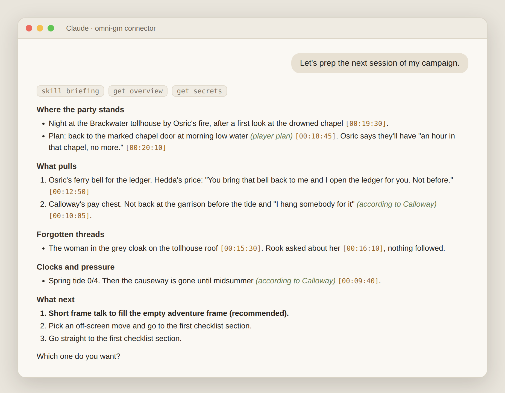

# Omni-GM

Omni-GM remembers your tabletop campaign between sessions. After you play,
your AI client reads the session transcript with you and records what changed.
When you sit down to prep, it opens with one page on where the story stands.
Every line on that page points back to the moment at the table it came from.
It works with D&D, Daggerheart, and other TTRPGs.



<sub>A prep briefing from a test run. The session, NPCs, and players are invented.</sub>

## The problem

You run a four-hour session. A week later you sit down to prep, and the
details are gone: the ferryman's wife's name, the deadline the warden set,
the stranger on the roof that one player asked about. Your notes caught some
of it. A recording caught all of it, but nobody listens to four hours again.

Omni-GM keeps your campaign's story state: NPCs, threads, clocks, places, and
character goals. Each entry records the transcript line it came from and who
said it, so an NPC's claim stays a claim and a player's guess stays a guess.
Nothing enters the store until you approve it.

## Get started

Add Omni-GM to your AI client. That is the whole setup.

In Claude Code, run this and then sign in with `/mcp`:

```sh
claude mcp add --transport http omni-gm https://useful-dinosaur-785.convex.site/mcp
```

In Claude Desktop or claude.ai, open Settings, then Connectors, choose
"Add custom connector", paste `https://useful-dinosaur-785.convex.site/mcp`,
and sign in.

Then tell your AI client:

> Debrief my last session. The transcript is in `session-12.txt`.

On first use it creates your campaign and asks which adventure the party
is in.

## Your transcript

Omni-GM reads text transcripts, not audio. Put one utterance per line with a
timestamp and the speaker:

```text
[00:01:10] GM as Sera Venn: Mind the stones, dear.
[00:02:20] Rowan: I bet she works for the raiders.
```

Timestamps must be in order, and a file can be up to 8 MB. Writing
`GM as <NPC>` for voiced NPCs is optional. The debrief matches speakers to
players, characters, and NPCs, and asks you when it can't tell and the
answer matters. Claude Code uploads the file from disk. Claude
Desktop and claude.ai give you a link to an upload page instead.

## A week with Omni-GM

1. **Debrief after the session.** Your AI client splits the transcript into
   scenes and drafts what changed. It shows you the draft as next session's
   briefing and asks at most five questions about gaps, such as a deadline
   without a clock. You answer, then commit.
2. **Prep before the next one.** Say "Let's prep the next session." It opens
   with the briefing above and offers a short talk about the adventure's
   goal, stakes, and timeframe.
3. **Walk your prep checklist.** Give it your checklist and session-note
   template once. For each section it lists the facts that matter. For
   sections like scenes and strong starts, it pitches two or three situations
   built on those facts. You pick, reshape, or ignore them.
   Only your picks go into the session note, in your words and template.

Background the players haven't seen yet, such as who really hired the
courier, goes in as a secret. Secrets stay apart from story state until a
debrief shows the table learned them.

## Your data

Each campaign belongs to one sign-in, and no other account can read it.
The Omni-GM server makes no AI calls of its own. Your AI client does the
reading and writing on your own plan, and the server stores and checks what
it sends. The server runs on Convex with WorkOS AuthKit sign-in.

## More

- [MCP reference](docs/reference.md) lists every tool, procedure, and limit.
- [Develop and prove](docs/development.md) covers the local gate, previews,
  and deployment.
- [ADR 0001](docs/adr/0001-store-over-mcp-is-the-single-truth.md) explains
  why the store over MCP is the single source of truth.

Omni-GM is MIT licensed.
